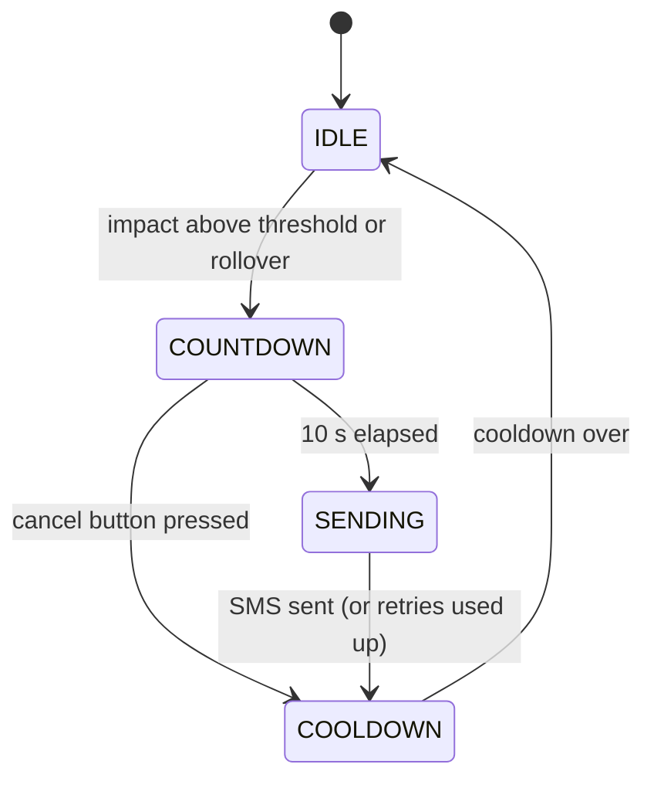

# Accident Detection & Alert System

An Arduino-based safety device that detects a crash or rollover with an accelerometer and, unless
cancelled, sends an SMS containing the vehicle's GPS location to an emergency contact.

> **Project note:** this repository contains firmware rewritten from the original project design
> (the original source files were lost). Pins and thresholds are defined in `config.h` and should
> be verified on the physical hardware. See [Calibration](#calibration).

## Features

- **Crash detection:** triggers on a high-g impact from the ADXL345 accelerometer (SPI, 100 Hz)
- **Rollover detection:** triggers when the vehicle stays tilted away from upright
- **Cancel window:** 10-second buzzer and LED countdown; a push button cancels false alarms
- **GPS + GSM alert:** SIM900A SMS with a Google Maps link from the NEO-6M (falls back to the last known position)
- **Reliability:** SMS retries, optional second contact, cooldown after each alert, and a fault indicator if the sensor is missing

## Hardware

| Component | Interface | Purpose |
|---|---|---|
| Arduino Uno / Nano | n/a | Controller |
| ADXL345 accelerometer | **SPI** | Impact and orientation sensing |
| NEO-6M GPS | **UART** | Location |
| SIM900A GSM | **UART** | SMS alerts |
| Push button, buzzer, LED | GPIO | Cancel input and local alarm |

Wiring and power: [docs/wiring.md](docs/wiring.md)

## How it works



1. **Idle:** samples the accelerometer at 100 Hz while parsing GPS data in the background.
2. **Trigger:** total acceleration above `IMPACT_G`, or Z-axis away from upright for `ROLLOVER_HOLD_MS`.
3. **Countdown:** buzzer and LED pulse so the rider can cancel a false alarm.
4. **Alert:** the firmware switches the software-serial listener from GPS to GSM, sends the SMS, then switches back.

Example SMS:

```
ACCIDENT ALERT! Impact detected (5.3g). Location: https://maps.google.com/?q=12.971599,77.594566
```

## Repository structure

```
.
├── README.md
├── LICENSE
├── .gitignore
├── docs/
│   └── wiring.md
└── firmware/
    └── accident_detector/
        ├── accident_detector.ino   # state machine
        ├── config.h                # pins and tuning
        ├── accel.h                 # ADXL345 SPI driver
        ├── gps.h                   # NEO-6M via TinyGPSPlus
        ├── gsm.h                   # SIM900A SMS (AT commands)
        └── secrets.example.h       # copy to secrets.h
```

## Getting started

### Requirements

- Arduino IDE 2.x
- Library (Library Manager): **TinyGPSPlus**

### Build and flash

1. Open `firmware/accident_detector/accident_detector.ino`.
2. Copy `secrets.example.h` to `secrets.h` and set `ALERT_NUMBER_1`.
3. Select **Arduino Uno** (or Nano) and your port, then upload.
4. Open the Serial Monitor at **115200 baud** to see readings.

## Calibration

1. Mount the sensor flat, Z up, and watch the `g=` and `z=` values (about 1.0 at rest).
2. Tap or shake the board to see the readings spike, and set `IMPACT_G` above normal bumps.
3. Tilt the board on its side and confirm `z` drops below `ROLLOVER_Z_G`.
4. Test the full alert on the bench with your own phone number before using it anywhere real.

## Safety

This is an educational prototype, not a certified safety device. Never test by crashing a vehicle;
simulate impacts by hand on the bench.

## Limitations and future work

- Threshold-based detection can false-trigger on potholes or drops (the cancel window mitigates this)
- SIM900A is **2G only**, so it needs a network that still supports 2G
- GPS needs open sky and may take minutes for a first fix
- Possible upgrades: 4G module (SIM7600), gyroscope fusion (MPU6050), speed-aware filtering, mobile app / live tracking

## License

MIT. See [LICENSE](LICENSE).
